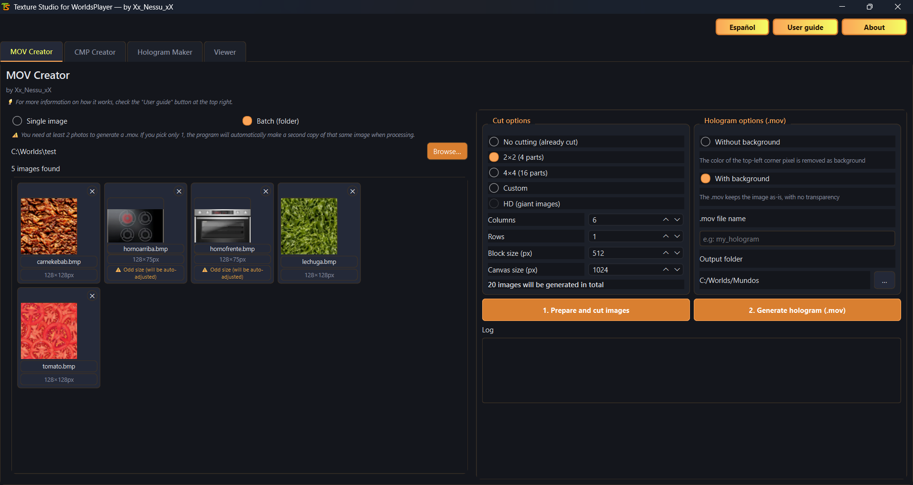
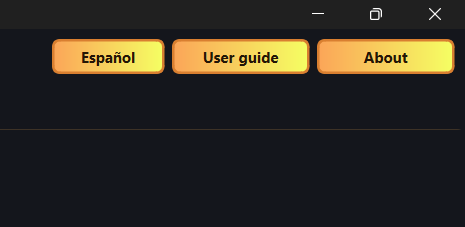

# Texture Studio for WorldsPlayer

Desktop app with 4 tabs to create and view WorldsPlayer textures and
holograms (.cmp / .mov): image cutting, batch packing, and a built in
viewer. Interface available in English and Spanish (switch with one
button).

## Tabs

1. **MOV Creator**: cuts images (grid, HD, or custom size) and generates
   the matching .mov hologram.
2. **CMP Creator**: converts a single image or a whole folder (batch) to
   .cmp, with optional transparency.
3. **Hologram Maker**: generates multi side holograms (8 sides by
   default) with optional tile support. Side 1 is the front view, side 2
   is the left view, and the rest rotate clockwise (seen from above) in
   equal 360/N increments.
4. **Viewer**: opens .cmp / .mov files with frame stepping, playback,
   zoom, and frame export, no external tools needed.

The top right bar gives access from any tab to switch language, open the
user guide (different per tab) and the About window.

## Download and setup

1. Download the .zip from the latest release.
2. Unzip it into any folder. Everything needed goes together:
   - `TextureStudio.exe`
   - `compimg.exe`
   - `cmpview.exe`
   - `default.mov`
3. Run `TextureStudio.exe`. No Python install or anything else required.

**Important:** do not move the .exe out of that folder. It needs
`compimg.exe` and `cmpview.exe` right next to it to work.

## Credits

- **Xx_Nessu_xX**: full program (Texture Studio).
- **vinnieWuff** (CMP Studio): codec for the .cmp/.mov format, used
  internally by the Viewer and to calculate hologram file names. Credit
  is also shown inside the app itself (Hologram Maker and Viewer tabs,
  and the About window).
- **Knowledge Adventure / Worlds Inc.**: `compimg.exe` and `cmpview.exe`,
  the original WorldsPlayer tools this app uses as its engine to
  generate and preview files. They are not part of this project and are
  distributed here only so the app can run.

## Source code

This repository ships only the executable and the files needed to run
it. Source code is not published.
